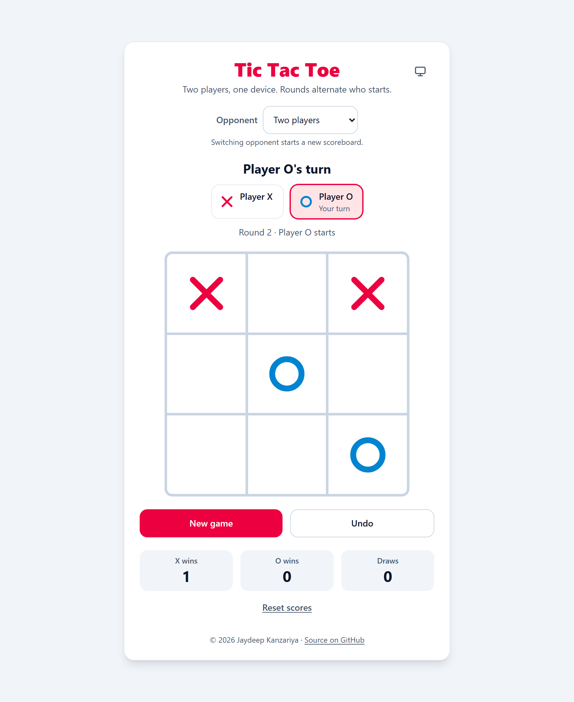
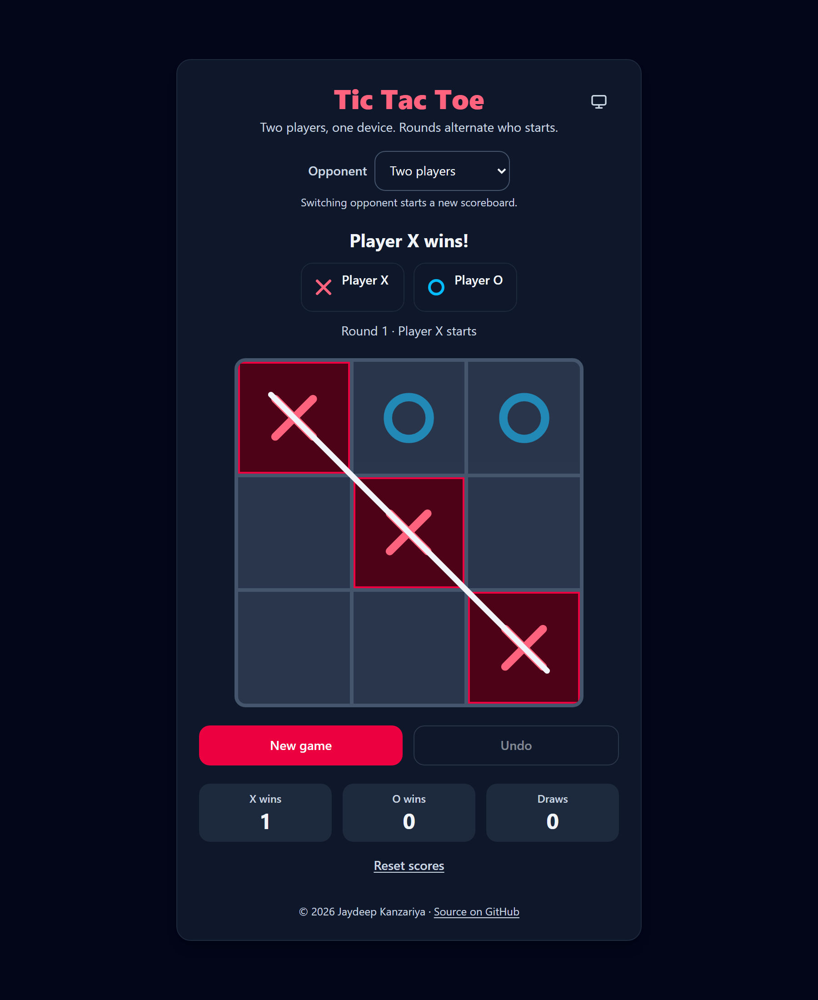
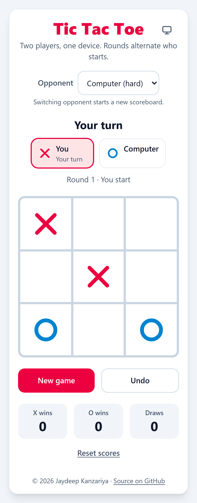
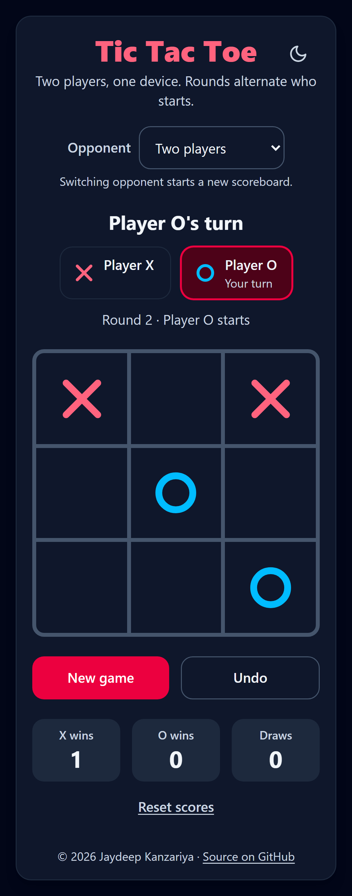

# Tic Tac Toe

A Tic Tac Toe game built with React, TypeScript and Tailwind CSS v4. Play a friend on the same device or the computer (easy or unbeatable), with a scoreboard, undo, light and dark themes and full keyboard support.

Live: https://tic-tac-toe-psi-nine-94.vercel.app/

## Screenshots
| Light, mid-game | Dark, X wins on the diagonal |
|---|---|
|  |  |

| Mobile (360 px), light, vs computer | Mobile (360 px), dark chosen with the toggle |
|---|---|
|  |  |

## Features
- 3x3 board of real buttons, X starts round 1, turns alternate
- Winner and draw detection; a win on the 9th move counts as a win
- Winning cells highlighted with an animated strike-through line; other cells dimmed; neutral draw state
- Status line (`aria-live`) and turn indicator chips with a text cue
- Rounds: the starter alternates each round; New game keeps the scores
- Play against the computer: easy (random) or hard (unbeatable minimax)
- Undo the last move (against the computer it takes back your move and the reply)
- Scoreboard (X wins, O wins, Draws), round and opponent persisted in `localStorage` with validation
- Reset scores asks for confirmation first
- X and O differ by shape and colour (rose and sky)
- Light and dark mode: follows the system by default, with a System / Light / Dark toggle, built on semantic design tokens
- Pop-in and line-draw animations, disabled under `prefers-reduced-motion`
- Social preview image and Open Graph tags

## Tech stack
React, Vite, TypeScript (strict), Tailwind CSS v4. Vitest and Testing Library for tests, oxlint for linting, GitHub Actions for CI. No other runtime dependencies.

## How to run
```
npm i
npm run dev
npm run build
npm run lint
npm test
```

## Project structure
```
src/
  main.tsx                     # StrictMode entry
  App.tsx                      # header, composes the game, footer
  App.test.tsx                 # component tests (Testing Library, jsdom)
  index.css                    # design tokens (light and dark), Tailwind theme, keyframes
  types.ts                     # shared types
  lib/game.ts                  # pure game logic, board replay, status text, win line geometry
  lib/ai.ts                    # computer moves: random and minimax
  lib/gameReducer.ts           # pure reducer and initial state
  lib/storage.ts               # safe, validated localStorage access
  lib/theme.ts                 # theme type and cycling
  lib/*.test.ts                # Vitest unit tests
  hooks/useGame.ts             # reducer, derived values, persistence, computer turn
  hooks/useTheme.ts            # applies and stores the chosen theme
  hooks/useRovingFocus.ts      # arrow-key navigation across cells
  components/                  # Board, Square, Mark, WinLine, StatusBar, ScoreBoard,
                               # GameControls, ResetScores, ModeSelect, ThemeToggle
public/og-image.png            # social preview image
.github/workflows/ci.yml       # lint, test and build on every push and pull request
```

## Theming
Colours are semantic design tokens declared once in `src/index.css`. Each token is a CSS variable defined as `light-dark(<light>, <dark>)` on `:root` and exposed to Tailwind through `@theme inline` (for example `bg-card`, `text-ink`, `text-ink-muted`, `border-grid`, `bg-accent`, `text-mark-x`). By default the colour scheme follows the system. The toggle sets `data-theme="light"` or `"dark"` on `<html>` to force one, and a tiny inline script in `index.html` applies the saved choice before first paint, so there is no flash of the wrong theme. Components never use palette colours or `dark:` variants, so a theme or the accent colour is changed in that one file.

| Token | Used for |
|---|---|
| `page`, `card`, `cell`, `subtle` | page background, card, board cells, score tiles |
| `line`, `grid` | card and chip borders, board grid lines |
| `ink`, `ink-muted` | primary and secondary text |
| `accent`, `accent-hover`, `on-accent`, `accent-soft`, `accent-ink` | buttons, winning cells, active turn chip, title |
| `mark-x`, `mark-o`, `focus` | X and O marks, focus ring |

## How the game logic works
State is one `useReducer` holding the list of `moves`, the `scores`, the `round` and the `mode`. The board is not stored: it is replayed from the moves, alternating from the round's starter. Everything else (starter, current player, winner, draw, status text, whether undo is possible) is derived on each render. `calculateWinner` checks the 8 `WINNING_LINES` and returns the winner with the winning line, and it is checked before `isDraw`. The pure reducer ignores invalid `PLAY` actions and updates scores in the same transition that ends the game, so a round is counted exactly once, including under StrictMode. Undo is just dropping the last move.

Against the computer the human is X and the computer is O. After each human move a short timer (cleaned up on unmount or change) asks `getComputerMove` for a reply and dispatches a normal `PLAY`. Easy picks a random empty cell. Hard runs minimax over the whole game tree, preferring quicker wins and slower losses, and picks randomly among equally good moves, so it never loses. The board ignores clicks while the computer is thinking.

## Testing
`npm test` runs 91 tests:
- **Game logic:** all 8 winning lines for X and O, draw and win-on-move-9, starter alternation, board replay, undo rules, win line geometry and status text.
- **Reducer:** occupied cells, game over, scoring once, undo, New game, Reset scores and switching opponent.
- **Computer:** easy only plays empty cells, hard wins and blocks, and an exhaustive search shows hard never loses, whether the human or the computer starts.
- **Storage:** corrupt JSON, negative values, unknown modes and unavailable `localStorage`.
- **Component tests:** the whole app in jsdom, covering turns, win and draw, arrow-key focus, New game, undo, the reset confirmation and focus return, the computer replying, the theme toggle and persistence across reloads.

GitHub Actions (`.github/workflows/ci.yml`) runs lint, tests and build on every push and pull request.

## Keyboard controls
- `Tab` moves focus onto the board (one cell is in the tab order)
- Arrow keys move between cells; `Home` and `End` jump to the first and last cell
- `Enter` or `Space` places a mark
- `Tab` to the buttons, then `Enter` or `Space` to use them
- `Escape` cancels the reset confirmation

## Decisions
- After New game, focus stays on the button (simpler, and focus is never lost).
- Undo and Reset scores use `aria-disabled` instead of `disabled`, so focus is not lost when they become inactive after a click.
- Reset scores opens an inline confirmation with Cancel focused, and focus returns to the Reset button afterwards.
- On reload, scores, round and opponent persist; the board starts empty.
- Switching opponent starts a new scoreboard, because mixed scores would not mean much.
- Undo is not available once a round has finished, so scores always match the board.
- Against the computer the human is always X, so in even rounds the computer moves first.
- Arrow keys do not wrap around the board edges.
- The Vite scaffold uses `oxlint` for linting, so I kept it instead of adding ESLint.
- The board is capped at `max-w-sm` so the card fits on a typical laptop screen.
- The theme toggle cycles System, Light, Dark. The `theme-color` meta tag follows the system setting only.
- Tests use Testing Library in jsdom rather than a real browser runner such as Playwright, to keep CI fast and free of browser downloads.

## Deploy on Vercel
| Setting | Value |
|---|---|
| Framework Preset | **Vite** |
| Root Directory | `./` (repo root) |
| Build Command | `npm run build` |
| Output Directory | `dist` |
| Install Command | `npm install` |
| Node.js version | latest LTS |

No environment variables are needed.

## License
MIT. See [LICENSE](LICENSE).
